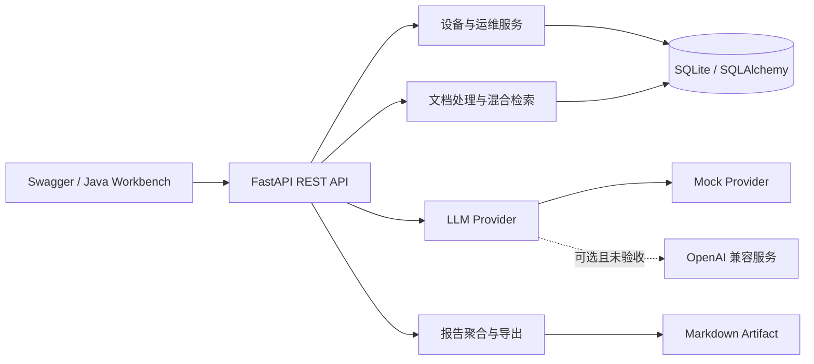

<div align="center">

# AI Hospital Operations Platform

**面向医疗设备运维的数据治理、RAG 检索、智能分析与报告服务**

`FastAPI` · `SQLAlchemy` · `RAG` · `Hybrid Retrieval` · `LLM Provider`

**Author: Hzhikai** · 基于相关实习经验独立重构 · 开源交流与共同学习

[English](README_EN.md) · [架构设计](docs/architecture.md) · [模块说明](docs/modules.md) · [数据流程](docs/flows.md) · [API](docs/api.md)

</div>

---

> 本仓库中的公开代码、架构设计与技术文档由 **Hzhikai** 基于本人实际项目经验独立整理并授权发布，用于 LLM 应用开发交流、开源共同学习与求职作品展示。欢迎阅读、引用、讨论和改进，并请保留作者与[许可证](LICENSE)信息。

## 项目定位

本项目将医疗设备台账、运维记录、知识文档和 AI 分析组织成可运行的后端服务，重点展示数据治理、检索增强生成、结构化 LLM 接入、任务化报告和工程测试能力。

仓库是基于实际实习场景重新设计并独立实现的公开工程，不包含企业原始源码、真实医院或患者数据、内部接口、访问凭据及模型资产，也不构成医疗诊断系统。

## 当前能力

| 业务模块 | 已实现能力 |
| --- | --- |
| 设备数据治理 | 台账新增、查询与更新、分页筛选、状态统计、唯一资产编号约束 |
| 运维记录 | 巡检、维护、故障、维修记录及严重级别统计 |
| 批量导入 | CSV、JSON、XLSX 解析，字段标准化、去重、更新与错误汇总 |
| RAG 知识库 | PDF、DOCX、TXT、Markdown 解析、按段落分块、元数据持久化 |
| 混合检索 | 关键词评分、确定性特征散列向量、RRF 融合、词项重排与引用溯源 |
| 智能分析 | Demo Mock 问答、OpenAI 兼容 Provider 接口、结构化风险建议 |
| 智能报告 | 周报、月报、自定义周期统计、SQL 任务结果复用、Markdown 导出 |
| 工程保障 | 配置校验、统一错误格式、请求 ID、输入边界、自动化测试 |

## 系统架构



[数据处理与问答流程](docs/flows.md)和[模块边界](docs/modules.md)均对应公开源码。

## 关键设计

### 1. 可追溯的混合检索

文档上传后完成格式解析、按段落分块和元数据持久化。查询同时计算关键词相关度与基于 SHA-256 特征散列的本地向量相似度，使用 Reciprocal Rank Fusion 合并候选，再通过查询词覆盖度重排。每条结果返回文档、分块和评分信息，问答结果保留引用来源。这里的向量不是模型生成的语义 Embedding，重排也不是学习式 Reranker。

### 2. 与业务解耦的模型接入

业务层只依赖统一 Provider 接口。Demo 使用确定性 Mock 返回结构化结果；源码另有 DeepSeek、Ollama 和 vLLM 的 OpenAI 兼容 HTTP 适配，凭据从环境变量读取。真实模型调用未在本次 Demo 验收中验证；仓库没有 Function Calling 或模型微调实现。

### 3. 可复用的报告任务

报告服务按统计周期聚合设备状态、事件类型和风险等级，以请求摘要在 SQL 任务表中查找并复用已完成结果。公开报告只输出汇总指标，不枚举资产编号或敏感明细。报告当前同步生成并导出 Markdown。

### 4. 可验证范围

| 当前代码可验证 | 尚未实现或未完成本机验收 |
| --- | --- |
| SQLite 数据治理、确定性本地检索、规则重排、Mock 问答、Markdown 报告 | Milvus 向量库、Redis 缓存、Function Calling、真实模型调用、MySQL 部署、LoRA 训练 |

`pyproject.toml` 中的可选依赖和 `.env.example` 中的预留字段不代表相关适配器已经实现。

## 快速开始（Windows Demo）

要求 Python 3.12：

```powershell
git clone https://github.com/Kailovek/ai-hospital-operations-platform.git
cd ai-hospital-operations-platform
.\setup.ps1
.\start.ps1
.\healthcheck.ps1
```

- Swagger UI：`http://127.0.0.1:8101/docs`
- OpenAPI JSON：`http://127.0.0.1:8101/openapi.json`
- 停止服务：`.\stop.ps1`

导入仓库自带的纯合成示例：

```powershell
curl.exe -X POST "http://127.0.0.1:8101/api/v1/imports/devices" -F "file=@examples/devices.csv"
```

生成可配置规模的演示台账：

```powershell
.\.venv\Scripts\python.exe .\scripts\generate_demo_data.py --count 1000 --output .\data\demo_devices.csv
```

生成器支持可配置记录数；仓库只提供少量示例，不预置大体积数据。

## 目录结构

```text
app/
├── core/          # 配置、错误与请求追踪
├── db/            # SQLAlchemy 模型和会话
├── modules/       # 设备、运维、导入、知识库、分析、报告
└── services/      # 文档解析、检索与 LLM Provider
docs/              # 架构、模块、数据流程与 API
examples/          # 纯合成设备台账及演示文档
scripts/           # 合成数据工具
tests/             # 单元与 API 集成测试
pyproject.toml      # 依赖与开发工具配置
```

## 配置与安全

复制 `.env.example` 为本地 `.env` 后按需修改。`.env`、数据库、日志、模型权重、Adapter、检查点和训练输出均已加入 `.gitignore`。前端或公开配置不得保存 API Key。

## 公开范围与许可证

- [PUBLICATION_SCOPE.md](PUBLICATION_SCOPE.md) 说明公开内容及明确排除项。
- [AUTHORS.md](AUTHORS.md) 记录作者与独立重构声明。
- 本仓库原创代码以 [MIT License](LICENSE) 开放，用于学习、交流和二次开发。
- 第三方依赖仍分别遵循其原始许可证。

欢迎通过 Issue 讨论工程设计与改进建议；使用者需自行评估其适用性，本项目不提供临床诊断或生产医疗系统保证。
