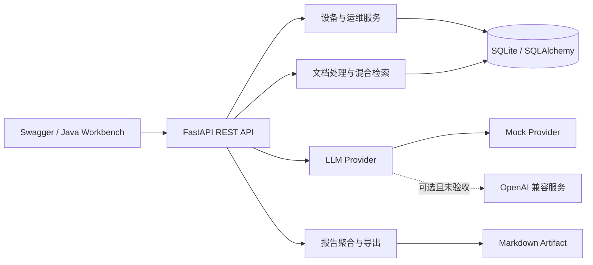
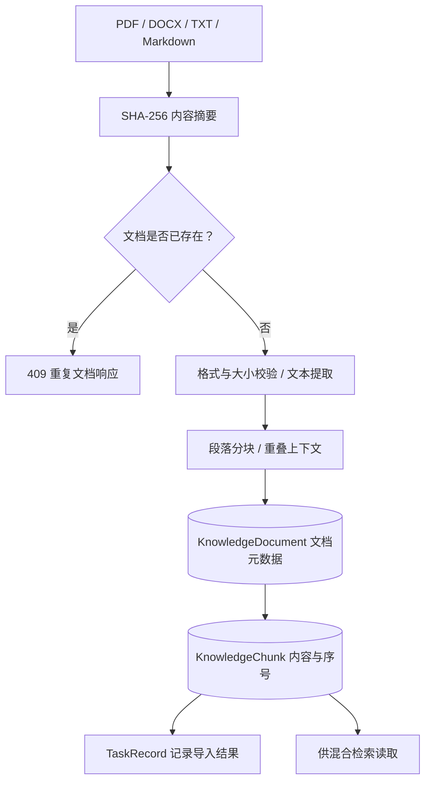
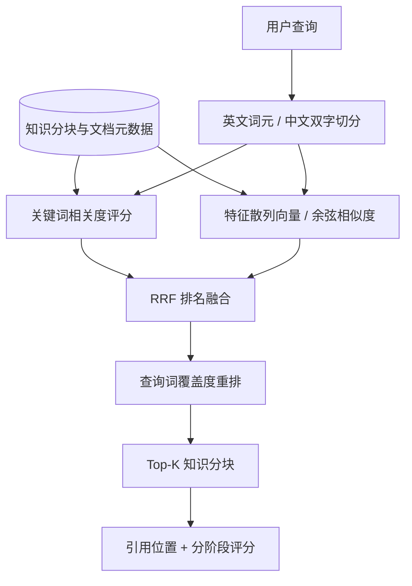
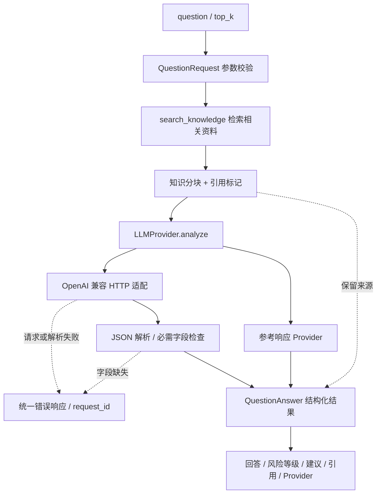
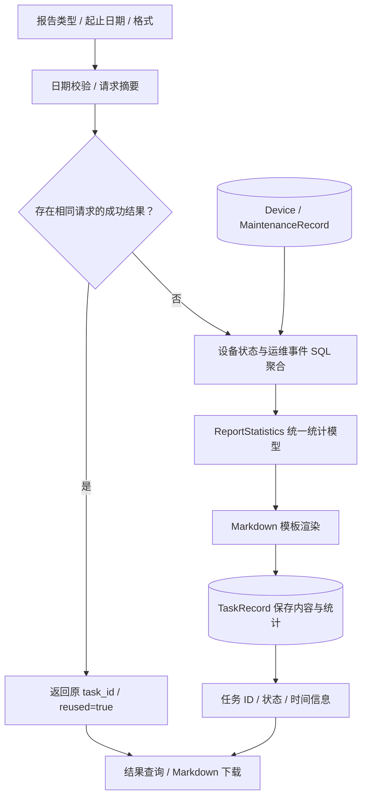

<div align="center">

# AI Hospital Operations Platform

**面向医疗设备运维的数据治理、RAG 检索、智能分析与报告服务**

`FastAPI` · `SQLAlchemy` · `RAG` · `Hybrid Retrieval` · `LLM Provider`

**Author: Hzhikai** · 基于相关实习经验独立重构 · 开源交流与共同学习

[English](README_EN.md) · [架构设计](docs/architecture.md) · [模块说明](docs/modules.md) · [数据流程](docs/flows.md) · [API](docs/api.md)

</div>

---

> 本仓库中的公开代码、架构设计与技术文档由 **Hzhikai** 基于本人实际项目经验独立整理并授权发布，用于 LLM 应用开发交流、开源共同学习与求职作品展示。欢迎阅读、引用、讨论和改进，并请保留作者与[许可证](LICENSE)信息。

## 项目定位

本项目将医疗设备台账、运维记录、知识文档和 AI 分析组织成可运行的后端服务，重点展示数据治理、检索增强生成、结构化 LLM 接入、任务化报告和工程测试能力。

仓库是基于实际实习场景重新设计并独立实现的公开工程，不包含企业原始源码、真实医院或患者数据、内部接口、访问凭据及模型资产，也不构成医疗诊断系统。

## 当前能力

| 业务模块 | 已实现能力 |
| --- | --- |
| 设备数据治理 | 台账新增、查询与更新、分页筛选、状态统计、唯一资产编号约束 |
| 运维记录 | 巡检、维护、故障、维修记录及严重级别统计 |
| 批量导入 | CSV、JSON、XLSX 解析，字段标准化、去重、更新与错误汇总 |
| RAG 知识库 | PDF、DOCX、TXT、Markdown 解析、按段落分块、元数据持久化 |
| 混合检索 | 关键词评分、确定性特征散列向量、RRF 融合、词项重排与引用溯源 |
| 智能分析 | Demo Mock 问答、OpenAI 兼容 Provider 接口、结构化风险建议 |
| 智能报告 | 周报、月报、自定义周期统计、SQL 任务结果复用、Markdown 导出 |
| 工程保障 | 配置校验、统一错误格式、请求 ID、输入边界、自动化测试 |

## 系统架构



[数据处理与问答流程](docs/flows.md)和[模块边界](docs/modules.md)均对应公开源码。

## 关键业务设计

### 1. RAG 知识库：从文档到可追溯知识单元

知识库把文件解析、内容组织和检索使用拆成独立步骤。上传内容先计算 SHA-256 摘要识别重复文档，再完成格式解析与按段落分块；文档元数据和知识分块分别存储，通过 `document_id` 与分块序号关联，使后续答案能够定位到具体资料。



- **内容去重**：按文件内容摘要判断重复，不依赖文件名，避免同一资料反复入库。
- **职责分离**：解析器处理文件格式，知识服务负责持久化，检索模块只读取统一的分块模型。
- **来源保留**：标题、文件名、文档 ID 与分块序号贯穿入库、检索和答案引用。

源码入口：[知识入库服务](app/modules/knowledge/service.py) · [文档解析与分块](app/services/document_parser.py) · [数据模型](app/db/models.py)

### 2. 混合检索：双路评分、排名融合与可解释重排

查询和知识分块使用统一词元规则处理英文词语与中文双字片段。关键词分支计算词频与逆文档频率相关度，向量分支计算 128 维确定性特征散列的余弦相似度；两路排序经 RRF 融合后，再结合查询词覆盖度进行重排，输出 Top-K 分块及各阶段评分。



- **统一评分入口**：同一个 `search()` 负责候选读取、双路排序、融合和返回，接口对业务层保持稳定。
- **排名融合**：使用 `1 / (60 + rank)` 累加两路排名贡献，融合依据是名次，而非直接相加不同尺度的原始分数。
- **结果可解释**：返回 `keyword_score`、`dense_score`、`fusion_score` 和 `rerank_score`，便于说明每个阶段如何影响排序。

这里采用确定性特征散列向量与词项重排；语义 Embedding、Milvus 和学习式 Reranker 属于后续适配方向。

源码入口：[混合检索实现](app/services/retrieval/local_hybrid.py) · [检索结果模型](app/modules/knowledge/schemas.py)

### 3. 智能分析：知识约束、Provider 隔离与结构化响应

分析接口先检索相关知识，再把问题、分块内容和引用标记交给统一的 `LLMProvider.analyze()`。业务路由负责组织流程与返回格式，Provider 负责模型协议、超时和响应解析，使模型接入细节与运维业务保持分离。



- **知识约束**：HTTP Provider 的提示要求基于给定上下文组织回答，接口同时保留引用供人工核对。
- **调用边界**：OpenAI 兼容适配封装请求格式与 30 秒超时；HTTP、JSON 解析和必需字段异常转换为明确的业务错误。
- **统一结果**：对外使用 `QuestionAnswer`，调用方按固定字段展示答案、建议与出处。

源码入口：[分析路由](app/modules/analysis/router.py) · [Provider 实现](app/services/llm/providers.py) · [响应模型](app/modules/analysis/schemas.py)

### 4. 智能报告：统计口径、结果复用与任务追踪

报告服务接收报告类型、起止日期和格式，先用请求摘要查找可复用的已完成结果；未命中时，从设备与运维记录聚合状态、事件类型和严重级别，再渲染 Markdown 并持久化结果。客户端通过任务 ID 查询和下载报告。



- **明确统计口径**：设备状态反映当前台账，运维事件使用 UTC 半开时间区间筛选，包含结束日期当天的全部记录。
- **减少重复计算**：同类型、周期和格式的请求可复用 SQL 中已保存的成功结果，并通过 `reused` 标识返回。
- **结果可追踪**：报告内容、统计、生成时间和任务状态一并保存；导出只包含汇总数据，不枚举资产编号。

当前报告由结构化统计与模板生成，并在请求内同步完成。更多调用顺序、统计边界与讲解路线见[业务设计与源码导读](docs/business-design.md)。

源码入口：[报告服务](app/modules/reports/service.py) · [报告 API](app/modules/reports/router.py) · [统计与任务模型](app/modules/reports/schemas.py)

## 当前公开范围

| 当前代码可验证 | 尚未实现或未完成本机验收 |
| --- | --- |
| SQLite 数据治理、确定性本地检索、规则重排、Mock 问答、Markdown 报告 | Milvus 向量库、Redis 缓存、Function Calling、真实模型调用、MySQL 部署、LoRA 训练 |

`pyproject.toml` 中的可选依赖和 `.env.example` 中的预留字段不代表相关适配器已经实现。

## 快速开始（Windows Demo）

要求 Python 3.12：

```powershell
git clone https://github.com/Kailovek/ai-hospital-operations-platform.git
cd ai-hospital-operations-platform
.\setup.ps1
.\start.ps1
.\healthcheck.ps1
```

- Swagger UI：`http://127.0.0.1:8101/docs`
- OpenAPI JSON：`http://127.0.0.1:8101/openapi.json`
- 停止服务：`.\stop.ps1`

导入仓库自带的纯合成示例：

```powershell
curl.exe -X POST "http://127.0.0.1:8101/api/v1/imports/devices" -F "file=@examples/devices.csv"
```

生成可配置规模的演示台账：

```powershell
.\.venv\Scripts\python.exe .\scripts\generate_demo_data.py --count 1000 --output .\data\demo_devices.csv
```

生成器支持可配置记录数；仓库只提供少量示例，不预置大体积数据。

## 目录结构

```text
app/
├── core/          # 配置、错误与请求追踪
├── db/            # SQLAlchemy 模型和会话
├── modules/       # 设备、运维、导入、知识库、分析、报告
└── services/      # 文档解析、检索与 LLM Provider
docs/              # 架构、模块、数据流程与 API
examples/          # 纯合成设备台账及演示文档
scripts/           # 合成数据工具
tests/             # 单元与 API 集成测试
pyproject.toml      # 依赖与开发工具配置
```

## 配置与安全

复制 `.env.example` 为本地 `.env` 后按需修改。`.env`、数据库、日志、模型权重、Adapter、检查点和训练输出均已加入 `.gitignore`。前端或公开配置不得保存 API Key。

## 公开范围与许可证

- [PUBLICATION_SCOPE.md](PUBLICATION_SCOPE.md) 说明公开内容及明确排除项。
- [AUTHORS.md](AUTHORS.md) 记录作者与独立重构声明。
- 本仓库原创代码以 [MIT License](LICENSE) 开放，用于学习、交流和二次开发。
- 第三方依赖仍分别遵循其原始许可证。

欢迎通过 Issue 讨论工程设计与改进建议；使用者需自行评估其适用性，本项目不提供临床诊断或生产医疗系统保证。
