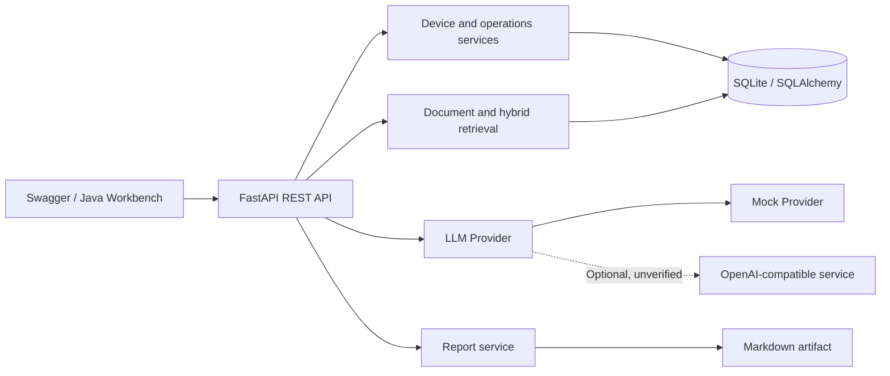

<div align="center">

# AI Hospital Operations Platform

**Data governance, RAG, intelligent analysis, and reporting for equipment operations**

`FastAPI` · `SQLAlchemy` · `RAG` · `Hybrid Retrieval` · `LLM Provider`

**Author: Hzhikai** · Independently rebuilt from relevant internship experience

[中文](README.md) · [Architecture](docs/architecture.md) · [Modules](docs/modules.md) · [Flows](docs/flows.md) · [API](docs/api.md)

</div>

---

> The public code, architecture designs, and technical documentation in this repository were independently organized and authorized for publication by **Hzhikai**, based on personal hands-on project experience. They are shared for LLM application development discussions, collaborative open-source learning, and portfolio presentation. Reading, citation, discussion, and improvements are welcome. Please retain the author attribution and [license](LICENSE) information.

## Overview

This runnable backend connects equipment inventory, maintenance events, knowledge documents, grounded AI analysis, and aggregate reporting. It demonstrates data governance, retrieval-augmented generation, structured provider integration, task-oriented reporting, and automated verification.

It is an independent public reconstruction. It contains no employer source code, hospital or patient data, internal endpoints, credentials, or model assets, and it is not a clinical diagnostic system.

## Capabilities

| Area | Implementation |
| --- | --- |
| Device governance | Create/read/update, pagination, filters, statistics, and unique asset codes |
| Operations records | Inspection, maintenance, fault, repair, and severity summaries |
| Batch import | CSV/JSON/XLSX parsing, normalization, deduplication, updates, and errors |
| RAG knowledge base | PDF/DOCX/TXT/Markdown parsing, paragraph-aware chunking, and metadata persistence |
| Hybrid retrieval | Keyword scoring, deterministic feature-hash vectors, RRF, term-overlap reranking, and citations |
| AI analysis | Demo Mock answers, OpenAI-compatible provider interface, and structured risk suggestions |
| Reports | Weekly, monthly, and custom aggregation, SQL task reuse, and Markdown export |
| Engineering | Configuration validation, unified errors, request IDs, bounds, and tests |

## Architecture



[Module boundaries](docs/modules.md) and [data flows](docs/flows.md) correspond to the published code.

## Design details

Document ingestion parses supported formats, creates overlapping paragraph chunks, and stores document metadata. Search combines lexical relevance and cosine similarity over a deterministic 128-dimensional SHA-256 feature hash. Reciprocal Rank Fusion merges rankings, then query-term coverage reranks the chunks. Each result includes a citation and individual scores. These vectors are not neural semantic embeddings, and the reranker is a transparent heuristic rather than a learned model.

The application depends on a provider interface. Demo uses a deterministic Mock; the code also defines HTTP adapters for DeepSeek, Ollama, and vLLM-compatible endpoints. Real provider calls have not been verified in the Demo run. The repository does not implement Function Calling or model fine-tuning.

Report requests aggregate device and maintenance counts, reuse a matching completed task from the SQL database, and synchronously export Markdown. Redis is not used.

| Verified Demo path | Not implemented or not locally verified |
| --- | --- |
| SQLite governance, local deterministic retrieval, heuristic rerank, Mock question answering, Markdown reports | Milvus, Redis, Function Calling, real model calls, MySQL deployment, LoRA training |

Optional packages and reserved environment variables do not imply working adapters.

## Windows Demo

Python 3.12 is required:

```powershell
git clone https://github.com/Kailovek/ai-hospital-operations-platform.git
cd ai-hospital-operations-platform
.\setup.ps1
.\start.ps1
.\healthcheck.ps1
```

- Swagger UI: `http://127.0.0.1:8101/docs`
- OpenAPI JSON: `http://127.0.0.1:8101/openapi.json`
- Stop: `.\stop.ps1`

Import the included synthetic example:

```powershell
curl.exe -X POST "http://127.0.0.1:8101/api/v1/imports/devices" -F "file=@examples/devices.csv"
```

Generate a larger local synthetic dataset when needed:

```powershell
.\.venv\Scripts\python.exe .\scripts\generate_demo_data.py --count 1000 --output .\data\demo_devices.csv
```

## Repository layout

`app/core/` holds configuration and errors; `app/db/` defines persistence; `app/modules/` contains devices, maintenance, import, knowledge, analysis, and reports; `app/services/` holds document parsing, retrieval, and providers. `examples/` contains small synthetic inputs; `scripts/` contains the generator; `tests/` contains unit and API checks; `docs/` explains the architecture and contracts.

## Security and licensing

Secrets are loaded from local environment variables. `.env`, databases, logs, weights, adapters, checkpoints, and outputs are ignored. See [PUBLICATION_SCOPE.md](PUBLICATION_SCOPE.md), [AUTHORS.md](AUTHORS.md), and [THIRD_PARTY_NOTICES.md](THIRD_PARTY_NOTICES.md).

The independently implemented code in this repository is released under the [MIT License](LICENSE) for learning and collaboration. Third-party dependencies retain their own licenses. This public reconstruction contains no employer source, patient information, or real hospital data and is not a clinical decision system.
