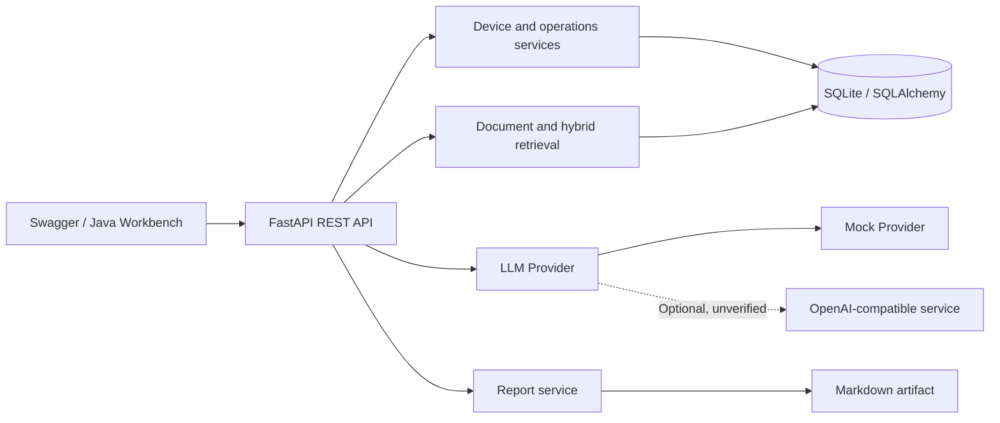
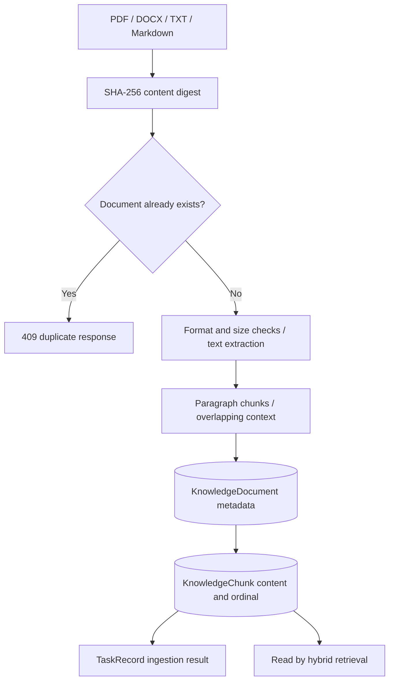
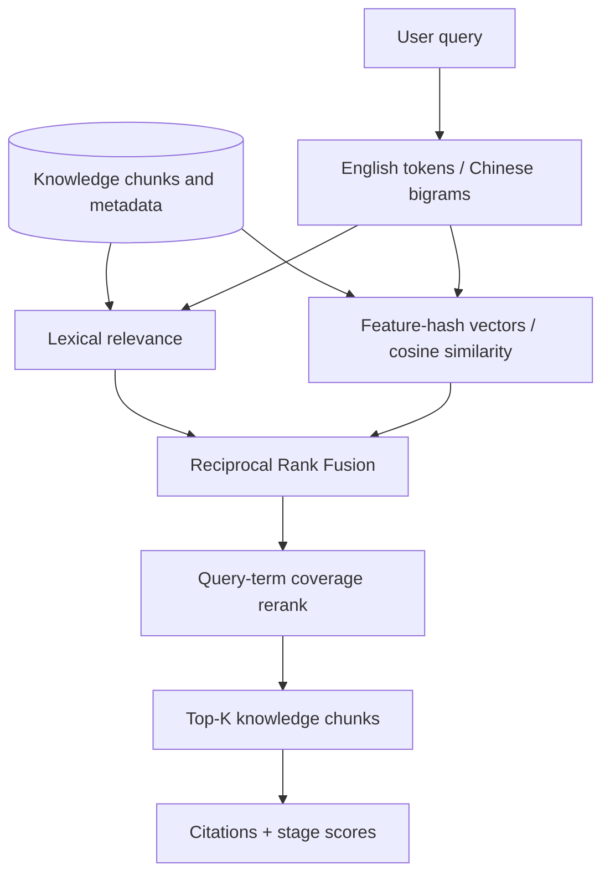
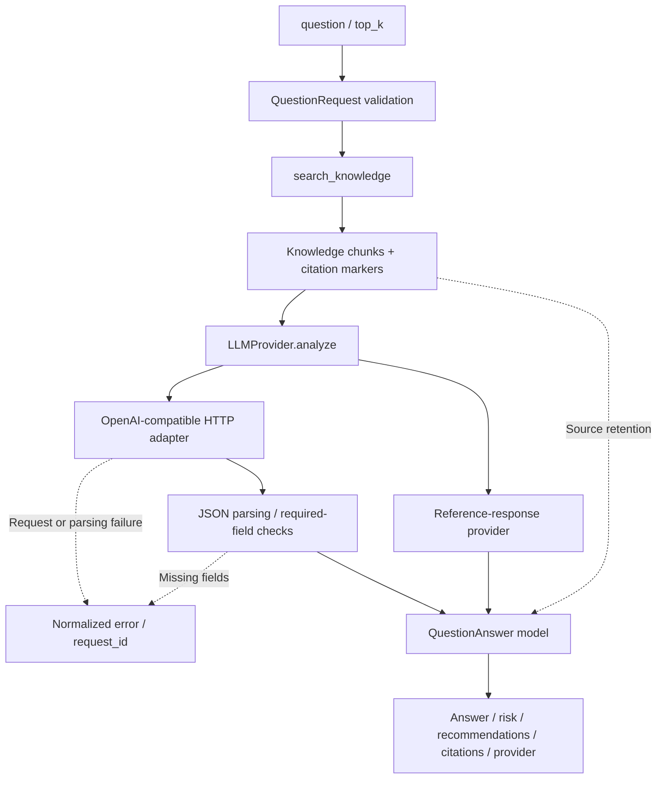
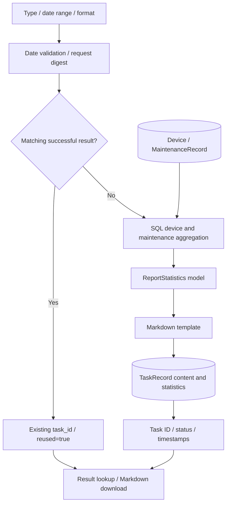

<div align="center">

# AI Hospital Operations Platform

**Data governance, RAG, intelligent analysis, and reporting for equipment operations**

`FastAPI` · `SQLAlchemy` · `RAG` · `Hybrid Retrieval` · `LLM Provider`

**Author: Hzhikai** · Independently rebuilt from relevant internship experience

[中文](README.md) · [Architecture](docs/architecture.md) · [Modules](docs/modules.md) · [Flows](docs/flows.md) · [API](docs/api.md)

</div>

---

> The public code, architecture designs, and technical documentation in this repository were independently organized and authorized for publication by **Hzhikai**, based on personal hands-on project experience. They are shared for LLM application development discussions, collaborative open-source learning, and portfolio presentation. Reading, citation, discussion, and improvements are welcome. Please retain the author attribution and [license](LICENSE) information.

## Overview

This runnable backend connects equipment inventory, maintenance events, knowledge documents, grounded AI analysis, and aggregate reporting. It demonstrates data governance, retrieval-augmented generation, structured provider integration, task-oriented reporting, and automated verification.

It is an independent public reconstruction. It contains no employer source code, hospital or patient data, internal endpoints, credentials, or model assets, and it is not a clinical diagnostic system.

## Capabilities

| Area | Implementation |
| --- | --- |
| Device governance | Create/read/update, pagination, filters, statistics, and unique asset codes |
| Operations records | Inspection, maintenance, fault, repair, and severity summaries |
| Batch import | CSV/JSON/XLSX parsing, normalization, deduplication, updates, and errors |
| RAG knowledge base | PDF/DOCX/TXT/Markdown parsing, paragraph-aware chunking, and metadata persistence |
| Hybrid retrieval | Keyword scoring, deterministic feature-hash vectors, RRF, term-overlap reranking, and citations |
| AI analysis | Demo Mock answers, OpenAI-compatible provider interface, and structured risk suggestions |
| Reports | Weekly, monthly, and custom aggregation, SQL task reuse, and Markdown export |
| Engineering | Configuration validation, unified errors, request IDs, bounds, and tests |

## Architecture



[Module boundaries](docs/modules.md) and [data flows](docs/flows.md) correspond to the published code.

## Core business design

### 1. RAG knowledge base: traceable knowledge units

Ingestion separates file parsing, content organization, and retrieval. A SHA-256 content digest detects duplicate documents before format parsing and paragraph chunking. Document metadata and chunks are stored separately and joined by document ID and ordinal, giving answers a stable source reference.



- **Content-based deduplication:** identical content is recognized even when filenames differ.
- **Separate responsibilities:** parsers handle formats, the knowledge service handles persistence, and retrieval consumes a common chunk model.
- **Source retention:** titles, filenames, document IDs, and ordinals connect ingestion, retrieval, and answer citations.

Source: [Ingestion service](app/modules/knowledge/service.py) · [Parser and chunker](app/services/document_parser.py) · [Data models](app/db/models.py)

### 2. Hybrid retrieval: two scoring paths and explainable fusion

Queries and chunks share English-token and Chinese-bigram rules. The lexical path scores term frequency and inverse document frequency; the vector path computes cosine similarity over a deterministic 128-dimensional feature hash. Reciprocal Rank Fusion merges the rankings, then query-term coverage reranks results before Top-K selection.



- **Stable entry point:** `search()` owns candidate loading, scoring, ranking, fusion, and result assembly.
- **Rank-based fusion:** each path contributes `1 / (60 + rank)`, avoiding direct addition of differently scaled raw scores.
- **Explainable results:** `keyword_score`, `dense_score`, `fusion_score`, and `rerank_score` expose the contribution of each stage.

The current implementation uses deterministic feature hashing and term-overlap reranking. Neural embeddings, Milvus, and a learned reranker are future integration directions.

Source: [Hybrid retrieval](app/services/retrieval/local_hybrid.py) · [Search result schema](app/modules/knowledge/schemas.py)

### 3. Intelligent analysis: grounded context and provider isolation

The analysis API retrieves knowledge first, then passes the question, chunks, and citation markers to `LLMProvider.analyze()`. The router assembles the business flow and response model; providers own HTTP protocols, timeouts, and response parsing.



- **Context grounding:** the HTTP provider prompt requests answers based on supplied context, while the API retains citations for human review.
- **Bounded calls:** the HTTP adapter encapsulates a 30-second timeout and translates request, JSON, and required-field failures into business errors.
- **Consistent output:** clients consume the fixed `QuestionAnswer` fields rather than provider-specific response envelopes.

Source: [Analysis router](app/modules/analysis/router.py) · [Provider implementations](app/services/llm/providers.py) · [Response schema](app/modules/analysis/schemas.py)

### 4. Intelligent reports: aggregation, reuse, and result tracking

The report service accepts a type, date range, and format. It first looks up a successful result using a request digest. On a miss, it aggregates device and maintenance records, renders Markdown, and persists the result. Clients use the task ID to retrieve and download the report.



- **Explicit statistics:** device status reflects the current inventory; maintenance events use a UTC half-open interval that includes the entire end date.
- **Result reuse:** the same type, date range, and format can reuse a completed SQL task, indicated by `reused`.
- **Traceable artifacts:** content, statistics, generation time, and task status are persisted together; exports contain aggregate values rather than asset identifiers.

Reports currently use structured statistics and templates and finish synchronously within the request. The [business design reading guide](docs/business-design.md) explains call order and implementation boundaries.

Source: [Report service](app/modules/reports/service.py) · [Report API](app/modules/reports/router.py) · [Report schemas](app/modules/reports/schemas.py)

## Current publication scope

| Verified Demo path | Not implemented or not locally verified |
| --- | --- |
| SQLite governance, local deterministic retrieval, heuristic rerank, Mock question answering, Markdown reports | Milvus, Redis, Function Calling, real model calls, MySQL deployment, LoRA training |

Optional packages and reserved environment variables do not imply working adapters.

## Windows Demo

Python 3.12 is required:

```powershell
git clone https://github.com/Kailovek/ai-hospital-operations-platform.git
cd ai-hospital-operations-platform
.\setup.ps1
.\start.ps1
.\healthcheck.ps1
```

- Swagger UI: `http://127.0.0.1:8101/docs`
- OpenAPI JSON: `http://127.0.0.1:8101/openapi.json`
- Stop: `.\stop.ps1`

Import the included synthetic example:

```powershell
curl.exe -X POST "http://127.0.0.1:8101/api/v1/imports/devices" -F "file=@examples/devices.csv"
```

Generate a larger local synthetic dataset when needed:

```powershell
.\.venv\Scripts\python.exe .\scripts\generate_demo_data.py --count 1000 --output .\data\demo_devices.csv
```

## Repository layout

`app/core/` holds configuration and errors; `app/db/` defines persistence; `app/modules/` contains devices, maintenance, import, knowledge, analysis, and reports; `app/services/` holds document parsing, retrieval, and providers. `examples/` contains small synthetic inputs; `scripts/` contains the generator; `tests/` contains unit and API checks; `docs/` explains the architecture and contracts.

## Security and licensing

Secrets are loaded from local environment variables. `.env`, databases, logs, weights, adapters, checkpoints, and outputs are ignored. See [PUBLICATION_SCOPE.md](PUBLICATION_SCOPE.md), [AUTHORS.md](AUTHORS.md), and [THIRD_PARTY_NOTICES.md](THIRD_PARTY_NOTICES.md).

The independently implemented code in this repository is released under the [MIT License](LICENSE) for learning and collaboration. Third-party dependencies retain their own licenses. This public reconstruction contains no employer source, patient information, or real hospital data and is not a clinical decision system.
