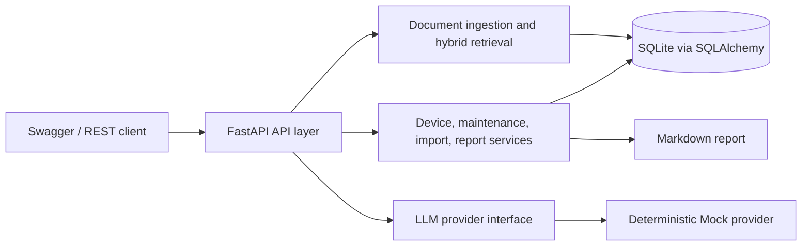
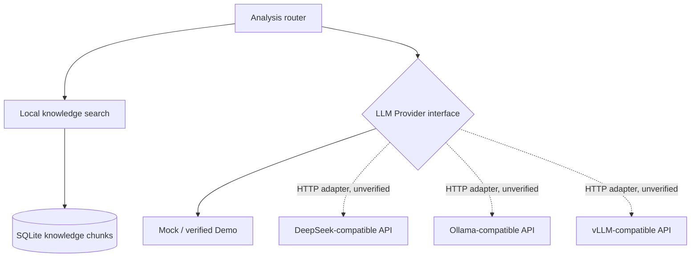
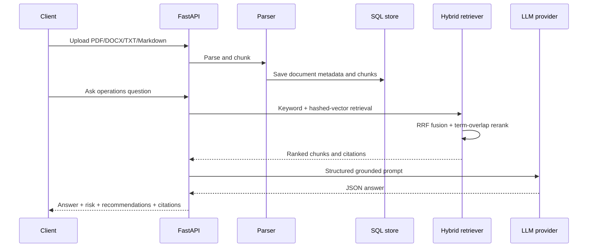

# Architecture

## Demo runtime

Demo mode keeps the complete application workflow local: SQLite provides persistence, a deterministic hashed vector plus keyword score implements hybrid retrieval, reciprocal-rank fusion combines candidates, token overlap reranks results, and the Mock provider returns structured grounded answers. It needs no model weights, GPU, API key, Redis, or Milvus.

## Model provider boundary

There are no Redis or Milvus runtime adapters. MySQL is a SQLAlchemy configuration possibility with an optional driver, not a verified deployment path. The fine-tuning service is an independent portfolio repository; this application does not call it.

## Knowledge workflow

## Design decisions

- API-first: stable `/api/v1` resources and generated Swagger documentation.
- Provider isolation: business code does not read API keys or call a vendor SDK directly.
- Health reports SQLite readiness, `cache: disabled`, and `vector_store: local` in Demo. These values do not imply Redis or Milvus availability.
- Input bounds: document/import content is checked against 15/10 MB limits after reading; page size and import error details are bounded. Chunking follows paragraph boundaries, so a very long paragraph can exceed the target chunk size.
- Privacy by construction: generated reports aggregate records and do not enumerate device identifiers.
