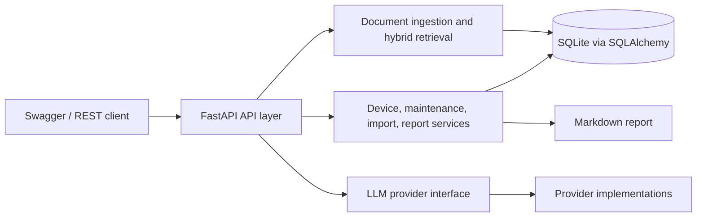
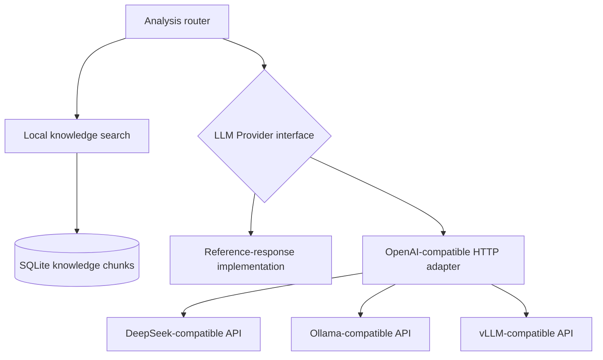
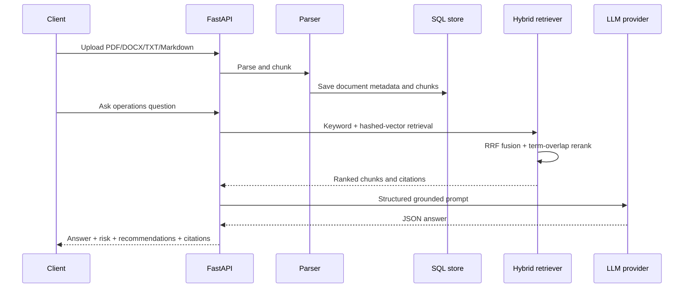

# Architecture

## Runtime architecture

The application separates HTTP routing, domain services, persistence, retrieval, and model-provider protocols. SQLAlchemy stores equipment, maintenance, document, and task records. Retrieval combines feature-hash vectors, keyword scoring, RRF, and term-overlap reranking; analysis assembles the resulting context and citations into a structured response.

## Model provider boundary

`build_provider()` centralizes provider selection. The analysis service calls the same `analyze(question, contexts)` interface, while the HTTP adapter encapsulates endpoint formats, request timeouts, JSON parsing, and required-field checks.

## Knowledge workflow

## Design decisions

- API-first: stable `/api/v1` resources and generated Swagger documentation.
- Provider isolation: model protocols and credentials belong to the provider layer; business code calls a common interface.
- Health reporting: the endpoint exposes database readiness, runtime mode, retrieval mode, and dependency status.
- Input bounds: document/import content is checked against 15/10 MB limits after reading; page size and import error details are bounded. Chunking follows paragraph boundaries, so a very long paragraph can exceed the target chunk size.
- Privacy by construction: generated reports aggregate records and do not enumerate device identifiers.
