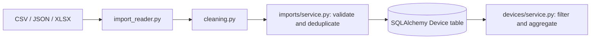
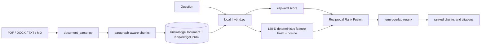
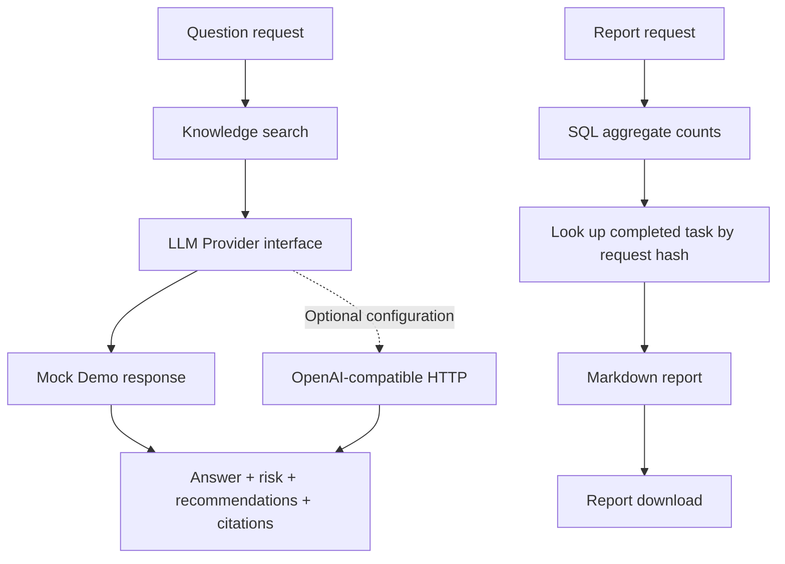

# Data and analysis flows

## Data governance

## Local hybrid retrieval

The vector branch is a lightweight deterministic retrieval feature, not neural embeddings. The rerank stage is a transparent heuristic, not a learned model.

## Question answering and reports

